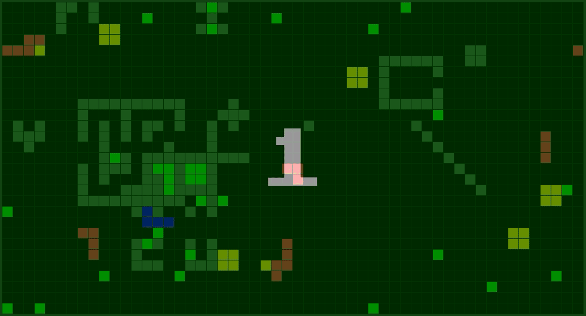

# Snake-Server


[](https://github.com/ivan1993spb/snake-server/releases/latest)
[](https://goreportcard.com/report/github.com/ivan1993spb/snake-server)
[](https://hub.docker.com/r/ivan1993spb/snake-server)

Snake-Server is a multiplayer Snake game server where you and your friends can
compete in real time. Its unique twist: snakes can eat each other!

[](https://snakeonline.xyz)

## Usage

1. `docker run --rm -p 8080:8080 ivan1993spb/snake-server --enable-web`
2. Open your browser: http://localhost:8080/.

## How to play?

* Create a game
* You have a snake
* You have to eat and grow
* You can eat apples, mice, watermelons, smaller and dead snakes
* If your snake dies, you start over

## Installation

* **Go get**

  ```
  go get github.com/ivan1993spb/snake-server@latest
  snake-server -h
  ```

* [**Via docker**](https://hub.docker.com/r/ivan1993spb/snake-server)

  ```bash
  docker run --rm ivan1993spb/snake-server -h

  docker run --rm -p 8080:8080 ivan1993spb/snake-server --enable-web
  ```

## CLI arguments

Use `snake-server -h` for more information.

Options:

* `--address` - **string** - sets an address to listen and serve (default: *:8080*). For example: *:8080*, *localhost:7070*
* `--conns-limit` - **integer** - to limit the number of opened web-socket connections (default: *1000*)
* `--groups-limit` - **integer** - to limit the number of games for a server instance (default: *100*)
* `--enable-web` - **bool** - to enable the embedded web client (default: *false*)
* `--forbid-cors` - **bool** - to forbid cross-origin resource sharing (default: *false*)
* `--log-json` - **bool** - to enable JSON log output format (default: *false*)
* `--log-level` - **string** - to set the log level: *panic*, *fatal*, *error*, *warning* (*warn*), *info* or *debug* (default: *info*)
* `--sentry-enable` - **bool** - to enable sending logs to sentry (default: *false*)
* `--sentry-dsn` - **string** - sentry's DSN (default: ""). For example: `https://public@sentry.example.com/44`
* `--tls-cert` - **string** - to specify a path to a certificate file
* `--tls-enable` - **bool** - to enable TLS
* `--tls-key` - **string** - to specify a path to a key file
* `--debug` - **bool** - to enable profiling routes

## Clients

There is an embedded JavaScript web client compiled into the server. You can
enable it with the CLI flag `--enable-web`.

Everyone is welcome to create a client! It's a great programming exercise if
you want to practice and can't think of your own project.

You can find examples here:

* VueJS client repo: https://github.com/ivan1993spb/snake-lightweight-client
* Python backend repo: https://github.com/ivan1993spb/snake-backend

## Docs

* REST API specification: [docs/api.md](docs/api.md) and [openapi.yaml](openapi.yaml).
* Web-Socket documentation [docs/websocket.md](docs/websocket.md).

## License

See [LICENSE](LICENSE).
